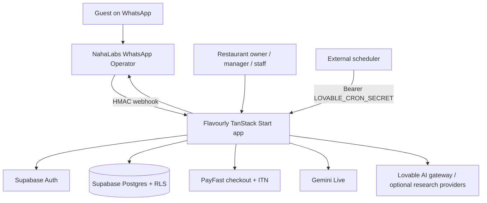

# Flavourly Client Handover

**Status: handover in progress — not approved for unattended client operation.** This pack separates repository evidence from owner-only and client acceptance checks. An unchecked item is not considered complete.

## What the app does

Flavourly is a restaurant operations app with tenant-scoped dashboard data, menu management, bookings/reminders, WhatsApp inbox and messaging, opt-out handling, loyalty/reward claims, campaigns, a Revenue Employee, and PayFast subscription billing. Actual feature availability depends on the deployed configuration and connected services.

## Architecture



The app's admin Supabase client uses the service-role key and bypasses RLS. This makes server-side authentication, role checks, and tenant scoping essential security boundaries. Browser code must only receive the Supabase URL and publishable key; service-role keys and other secrets belong only in hosting secret settings.

## Run locally

Prerequisites: Node.js 22, Bun, Git, and access to the project’s required secrets/services.

1. Clone the repository and enter the directory.
2. Copy `.env.example` to a local `.env` file and fill the values needed for the features under test. Never copy production secrets into a ticket or chat.
3. Install the locked dependencies and run checks:

   ```sh
   bun install --frozen-lockfile
   bun run check:env
   bun run typecheck
   npx eslint . --rule 'prettier/prettier: off'
   bun run test
   bun run build
   ```

4. Start locally with `bun run dev`. Do not use real guest phone numbers, live PayFast credentials, or a production database during testing.

The Playwright-style E2E package lives under `e2e/` and has its own dependencies. Its reproducible install/lock and CI execution are still open items; don't assume the E2E suite is covered by the root build.

## Repository rules

- Never rewrite published Git history; add new commits only.
- Never manually edit `src/integrations/supabase/*` or `src/routeTree.gen.ts`; regenerate the Supabase types through the supported generator.
- Use one concern per commit.
- Run the CI checks above before proposing a merge.
- Do not merge the hardening PR until its CI is green and the pending security/acceptance gates below are closed.
- Do not apply schema changes to production without verifying the migration on a scratch database and following the migration/change procedure.

## Current verified evidence

- GitHub Actions: [latest recorded successful run](https://github.com/Naha1981/flavourly-2-lovable/actions/runs/40165684375) for the security/PayFast commit. This run covers frozen Bun install, root typecheck, ESLint, Vitest, and Vite build.
- The clean Supabase migration replay, PayFast sandbox lifecycle, live deployment settings, real WhatsApp operator, alerts, and client click-through acceptance have not been evidenced by that CI run.
- The audit branch and changes are in a draft PR: [PR #25](https://github.com/Naha1981/flavourly-2-lovable/pull/25). Check the PR for the newest run and commits before acting on the earlier evidence link.

## Gate status

See the parent handover report / PR for the live gate table. Until every gate has an evidence link and all owner items have been signed off, the recommendation remains **Not ready**.
